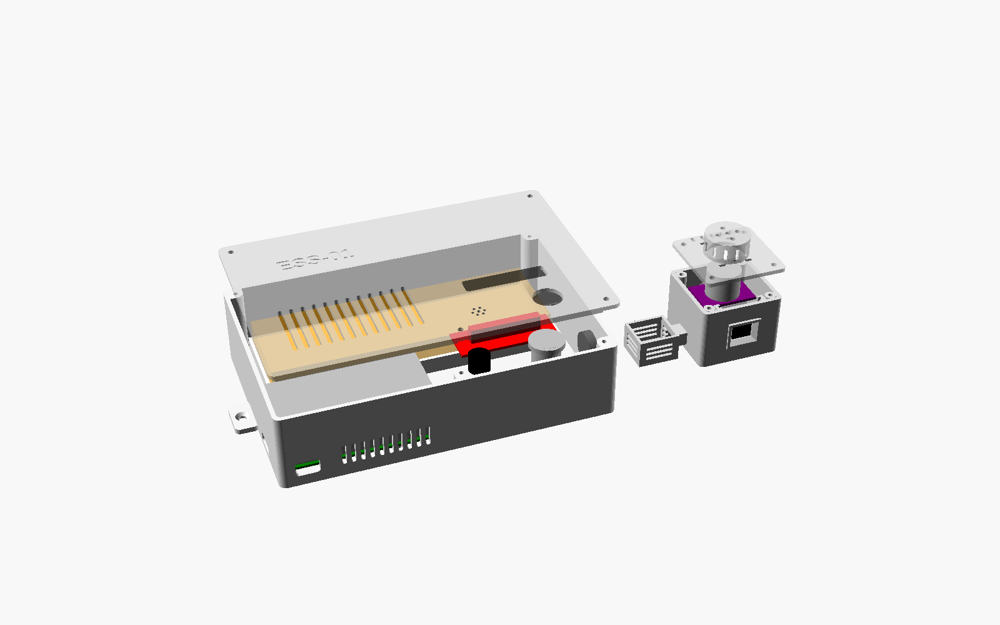

# ESS-01 화재 감지기 케이스 (3D 프린트, 2026-11-04)

보조배터리 벤치 구성(220 V 없음)용 케이스. **제어함**과 **센서 헤드** 두 덩어리이고, 보조배터리는 밖에 둔다.
설계 원본은 `ess01_case.scad` (OpenSCAD, 파라메트릭) 하나이고, STL 은 거기서 뽑은 것이다.



| 파일 | 무엇 | 크기 (mm) | 출력 방향 |
|---|---|---|---|
| `stl/ess01_fit_test.stl` | **먼저 뽑을 맞춤 시험 조각 5 개** | 208 x 104 x 31 | 그대로 |
| `stl/ess01_box_base.stl` | 제어함 본체: Pi 5, 풀 브레드보드(MB-102 830) | 211 x 124 x 44 (귀 포함) | 그대로 (바닥이 아래) |
| `stl/ess01_box_lid.stl` | 제어함 뚜껑: 신호등 LED 창과 레일, 부저, 버튼 구멍, Pi 배기구 | 187 x 124 x 15 | 그대로 (바깥 면이 아래) |
| `stl/ess01_head_body.stl` | 센서 헤드: AMG8833 창과 후드, SHT31 통풍 상자, 삼각대 너트 자리 | 81 x 50 x 36 | 그대로 |
| `stl/ess01_head_lid.stl` | 헤드 뚜껑: MQ-2 구멍과 보호 캡 | 49 x 47 x 14 | 그대로 (캡이 위) |

모든 부품은 서포트 없이 250 x 250 mm 베드에 하나씩 들어간다. 필라멘트는 전부 합쳐 최대 약 320 g (속을 꽉 채웠을 때 기준).

## 도면 (DXF, A3)

`drawings/out/` 에 부품별 2D 도면 4 장이 있다. 3D 모델을 잘라(단면) 비추어(투영) 뽑은 것이라 STL 과 치수가 같다.

| 파일 | 부품 | 척도 | 보기 |
|---|---|---|---|
| `ESS01-CASE-01_제어함본체.dxf` | 제어함 본체 | 1:2 | 평면도, 정면도, 좌, 우측면도 |
| `ESS01-CASE-02_제어함뚜껑.dxf` | 제어함 뚜껑 | 1:1 | 평면도(안쪽 레일은 파선), 단면 A-A |
| `ESS01-CASE-03_센서헤드본체.dxf` | 센서 헤드 본체 | 1:1 | 평면도, 정면도, 좌, 우측면도, 배면도 |
| `ESS01-CASE-04_센서헤드뚜껑.dxf` | 센서 헤드 뚜껑 | 2:1 | 평면도, 정면도 |
| `ESS01-CASE_도면_A3.pdf` | 4 장 모음 | | 인쇄, 공유용 |

- **형식:** DXF R2013, 단위 mm, 제3각법. 오토캐드에서 열어 `다른 이름으로 저장` 하면 DWG 가 된다.
- **레이어:** OUTLINE 외형선, HIDDEN 숨은선, CENTER 중심선, DIM 치수, TEXT 글자, FRAME 도면틀, CUTLINE 단면 표시, ENGRAVE 새김 글자.
- **치수 표기:** 그림에는 전체 치수만 두고, 구멍과 자리는 기호(P1, U1 등)와 **위치표**(외곽 왼쪽 앞 아래 모서리 기준 좌표, 크기)로 적었다.
- **한글 글꼴:** 문자 스타일 `KOR` 의 글꼴은 `malgun.ttf` (맑은 고딕, 한글 윈도). 다른 환경에서 한글이 깨지면 이 스타일의 글꼴만 바꾼다.
- **다시 뽑기:** scad 변수를 바꾼 뒤 `cd drawings && python3 make_drawings.py && python3 preview.py && python3 pdf.py` 를 실행한다. `openscad`, `pip install ezdxf matplotlib`, 한글 글꼴(fonts-nanum)이 필요하다.

## 1. 배치

**제어함** (안쪽 182 x 119 x 42)

- **Pi 5:** 왼쪽 앞에 둔다. 받침 4 개에 M2.5 나사로 고정한다.
  - USB-C 전원은 앞벽 구멍으로 바로 꽂는다 (보조배터리 선).
  - microSD 는 왼쪽 벽 홈으로 꺼낸다.
  - GPIO 핀은 뒤쪽 브레드보드를 향한다.
- **브레드보드:** 뒤쪽에 둔다. 바닥 네 모서리의 ㄱ 자 턱 사이에 원래 붙어 있는 양면테이프로 붙인다. ADS1115 는 브레드보드 위에 꽂는다.
- **뚜껑:**
  - 오른쪽 앞에 신호등 LED 창(레일에 모듈을 밀어 넣음), 부저(테에 끼움), 래치 해제 버튼 구멍(16 mm, HX16-B1)이 있다.
  - Pi 바로 위에는 배기 홈이 있고, 앞벽 아래 흡기 홈과 짝을 이룬다.
- **센서 헤드로 가는 선:** 오른쪽 벽의 PG9 케이블 그랜드로 나간다.
- **벽걸이:** 양 옆 귀에 M4 나사로 건다 (바닥이 벽 쪽).

**센서 헤드** (안쪽 44 x 42 x 34)

- **AMG8833:** 앞벽 뒤 레일에 위에서 떨어뜨려 넣는다.
  - 센서 몸통이 앞벽 창을 지나 바깥 면과 거의 맞닿는다.
  - 앞의 후드는 35° 로 벌어져 있어 60° 화각을 가리지 않는다.
  - **창 앞을 테이프, 필름, 투명 판으로 막으면 안 된다.** 적외선은 플라스틱을 거의 지나가지 못한다.
- **MQ-2:** 뚜껑 구멍으로 금속망이 올라오게 끼운다. 기판은 뚜껑 밑에 케이블타이 2 개로 묶는다.
  - 뚜껑 위 캡에 옆 홈과 위 구멍이 있어 공기는 통하고, 뜨거운 망에 손은 닿지 않는다.
- **SHT31:** 헤드 왼쪽에 8 mm 떨어진 통풍 상자 안에 둔다.
  - MQ-2 히터 열을 덜 받게 하려는 것이다. SHT31 값이 판정의 기준(주변 온도)이라, 열을 받으면 뜨거운 화소 판정이 틀어진다.
  - 선은 상자와 헤드를 잇는 속 빈 목으로 지나간다. 케이블타이 하나로 고정한다.
- **나머지:** 뒷벽에 PG9 그랜드, 바닥에 카메라 삼각대 1/4" 나사 자리(안에 육각 너트)가 있다.
- **설치:** 감시 대상 앞쪽 위 약 0.5 m 에 두고 비스듬히 내려다보게 한다.

## 2. 출력 설정

| 항목 | 값 |
|---|---|
| 재료 | **PETG** 권장 (MQ-2 금속망이 50 ℃ 넘게 뜨거워짐. PLA 는 그 근처에서 무르기 시작) |
| 층 높이 | 0.2 mm |
| 벽 | 3 줄 이상 (설계 벽 두께 2.4 mm, 0.4 노즐) |
| 채움 | 20~30 % |
| 서포트 | 없음 |
| 브림 | 제어함 본체 모서리가 들리면 5 mm |

## 3. 먼저 할 것: 맞춤 시험 조각 (약 1 시간)

`ess01_fit_test.stl` 을 먼저 뽑아 실물을 대 본다. 조각마다 아래 변수를 고치면 된다.

| 조각 | 대 볼 것 | 안 맞으면 고칠 변수 |
|---|---|---|
| A 제어함 왼쪽 앞 모서리 | USB-C 플러그가 구멍에 들어가는지, Pi 를 받침에 올렸을 때 USB-C 가 구멍 가운데에 오는지, microSD 를 꺼낼 수 있는지, M2.5 나사가 받침에 들어가는지 | `usbc_cut`, `pi_usbc_x`, `pi_pos`, `pi_pilot` |
| B 뚜껑 LED, 부저, 버튼 | LED 모듈을 레일에 밀어 넣으면 LED 가 창 밑에 오는지, 부저가 테에 끼는지, 버튼 나사산이 구멍에 맞는지 | `led_pcb`, `led_standoff` (LED 높이 + 0.5), `led_window`, `buzzer_d`, `button_d` |
| C 헤드 앞벽 | AMG8833 기판이 레일에 미끄러져 들어가는지, 센서 몸통이 창 가운데로 나오는지 | `amg_pcb`, `amg_pkg_off` (기판 중심에서 센서 중심까지), `amg_pkg_h` |
| D MQ-2 구멍과 캡 | 금속망이 구멍을 지나는지, 캡 안에서 닿지 않는지, 케이블타이가 기판 바깥을 지나는지 | `mq2_can_d`, `mq2_cap_h`, `mq2_tie_dx`, `mq2_tie_dy` |
| E 그랜드, 삼각대 너트 | PG9 나사가 들어가는지, 1/4" 너트가 육각 자리에 들어가는지 | `gland_d`, `head_gland_d` |

**특히 재야 할 것.** 모듈마다 크기가 달라 기본값은 흔한 제품 기준의 추정치다.

| 부품 | 기본값 (mm) | 재는 곳 |
|---|---|---|
| 신호등 LED 모듈 | 기판 56 x 21, LED 높이 8.6 이하 | 기판 가로, 세로, 기판 윗면에서 LED 꼭대기까지 |
| AMG8833 모듈 | 기판 26 x 18, 센서가 기판 가운데 | 기판 가로, 세로, 센서 중심 위치 |
| MQ-2 모듈 | 금속망 지름 19.9, 뚜껑 위로 나오는 높이 10 이하 | 금속망 지름 |
| SHT31 모듈 | 상자 안쪽 약 21 x 19 | 기판 가로, 세로 |
| 부저 TMB12A05 | 지름 12 | 지름 |

뚜껑 쪽 끼움이 빡빡하면 `tol` (기본 0.3) 을 0.4 로 올린다.

## 4. 고쳐서 다시 뽑기

1. [OpenSCAD](https://openscad.org) 를 설치하고 `ess01_case.scad` 를 연다.
2. 맨 위 `part` 를 `"box_lid"` 처럼 바꾸거나, Window → Customizer 창에서 묶음별 변수를 고친다.
3. F6 (Render) 를 누르고 F7 (Export STL) 을 누른다.

명령줄로 한 번에 뽑을 수도 있다:

```bash
for p in box_base box_lid head_body head_lid fit_test; do
  openscad -o ess01_$p.stl -D "part=\"$p\"" ess01_case.scad
done
```

`part="assembly"` 는 부품 모형(Pi, 브레드보드, LED, 부저, 버튼, AMG8833, MQ-2)을 넣은 조립 미리보기이다.
`part="clearance_box"`, `"clearance_lid"`, `"clearance_head"` 는 케이스와 부품 모형이 겹치는 부분만 남긴다.
비어 있어야 정상이다 (`Current top level object is empty`). 치수를 바꾼 뒤 한 번 돌려 보면 좋다.

## 5. 준비물

| 품목 | 수량 | 쓰는 곳 |
|---|---|---|
| M3 x 8 셀프태핑 나사 (또는 M3 볼트와 열 인서트, 그때는 `screw_pilot = 4.0`) | 8 | 제어함 뚜껑 4, 헤드 뚜껑 4 |
| M2.5 x 6 셀프태핑 나사 | 4 | Pi 5 |
| PG9 케이블 그랜드 (나사 지름 15.2, 선 4~8 mm) | 2 | 제어함 오른쪽 벽, 헤드 뒷벽 |
| 8 심 랜선 1 m 이하 | 1 | 제어함과 헤드 사이 (I2C, 3.3 V, 5 V, MQ-2 AO, GND) |
| 케이블타이 폭 3.6 mm 이하 | 3 | MQ-2 2, SHT31 1 |
| 1/4"-20 육각 너트 (선택) | 1 | 삼각대 |
| M4 나사 (선택) | 2 | 벽걸이 |

## 6. 조립 순서

1. **전원과 시험 조각:** 보조배터리를 뺀 상태에서 시작한다. 시험 조각으로 치수를 맞춘 뒤 본 부품을 뽑는다.
2. **제어함:**
   - Pi 5 를 받침에 올리고 M2.5 나사로 고정한다. USB-C 가 앞벽 구멍 가운데에 오는지 본다.
   - 브레드보드를 ㄱ 자 턱 사이에 붙이고, 지금 결선을 옮겨 꽂는다.
3. **뚜껑:**
   - LED 모듈을 +X 쪽(오른쪽) 열린 끝에서 레일로 밀어 넣는다.
   - 부저는 테에 끼운다. 헐거우면 순간접착제나 글루건을 한 점 쓴다.
   - 버튼을 쓰면 구멍에 넣고 너트로 조인다.
4. **센서 헤드:**
   - AMG8833 을 레일에 위에서 넣는다.
   - SHT31 을 통풍 상자에 넣고 선을 목으로 들인다.
   - MQ-2 를 뚜껑에 끼우고 케이블타이로 묶는다.
5. **랜선:** 랜선을 양쪽 그랜드에 통과시켜 연결한다. **SDA, SCL 선에 표시**해 둔다 (11-01 에 뒤바뀐 적 있음).
6. **확인:**
   - `sudo i2cdetect -y 1` 에 44, 48, 69 가 보이는지 확인한다.
   - 뚜껑을 닫고 `tools/bench_test.py` 로 전체 기능 시험을 한다.

## 7. 주의

- **뚜껑을 덮은 뒤 Pi 온도:** 뚜껑을 닫으면 Pi 가 더 더워진다. `vcgencmd measure_temp` 가 80 ℃ 에 가까우면 Active Cooler 를 달거나 배기 홈을 막지 않았는지 본다. 기록의 `device_health` 에도 CPU 온도가 남는다.
- **MQ-2 열:** MQ-2 캡이 따뜻해지는 것은 정상이다. 열화상 시야에 MQ-2 가 들어오지 않게 헤드를 놓는다. 캡은 AMG8833 뒤쪽 위에 있어 보통은 시야 밖이다.
- **치수 기준:** 220 V 구성(SSR, 단자대)용이 아니다. 220 V 로 돌아가면 기존 계획대로 하이박스를 쓴다.
